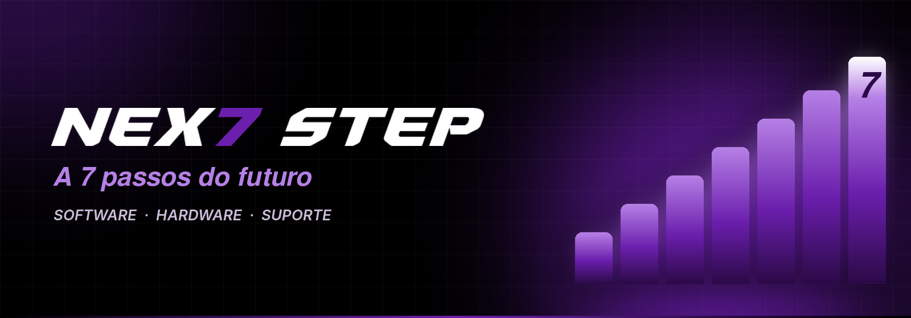

 

### 🟣 Nex7 Step
**Software, hardware e suporte para o seu negócio dar o próximo passo.**

---

## 🧭 Quem somos

A **Nex7 Step** une **software, hardware e soluções inteligentes** para ajudar negócios a crescerem com tecnologia. Do sistema que organiza a empresa até a plaquinha que leva o cliente até você com um toque, a gente cuida de cada passo.

> **"A 7 passos do futuro."**

O **7** é a assinatura da marca: sete degraus que sobem, com o último em destaque.

---

## 🛠️ O que fazemos

| | Frente | O que entregamos |
| :-: | :-- | :-- |
| 💻 | **Sistemas sob medida** | Painéis, controle de estoque, agendamentos e automações que descomplicam a rotina. |
| 🌐 | **Sites e landing pages** | Páginas rápidas e completas, pensadas para o cliente entrar em contato, conhecer a marca ou comprar. |
| 🔧 | **Assistência técnica** | Manutenção, formatação, diagnóstico e reparo de computadores e equipamentos. |
| 🤖 | **Soluções inteligentes** | Automações, integrações e ferramentas que economizam tempo e cortam tarefas repetitivas. |
| 🧩 | **Produtos em impressão 3D** | Plaquinhas NFC e QR Code, chaveiros e peças personalizadas. |

---

## 📲 Produtos

<table>
  <tr>
    <td align="center" width="25%"><b>Plaquinhas NFC e QR Code</b> Google, Pix, Instagram, WhatsApp, Wi-Fi e cardápio</td>
    <td align="center" width="25%"><b>Placa 3 em 1</b> Você escolhe as três funções em uma única peça</td>
    <td align="center" width="25%"><b>Chaveiros de programador</b> Java, Python, JavaScript, C#, GitHub, VS Code e mais</td>
    <td align="center" width="25%"><b>Sob encomenda</b> Sua marca, suas cores, sua ideia</td>
  </tr>
</table>

O cliente aproxima o celular ou lê o QR Code e chega direto ao destino.

---

## 🧱 Como a gente constrói

Gostamos de soluções **enxutas e que funcionam**. O site da marca, por exemplo, é feito em **HTML, CSS e JavaScript puro**, sem framework e sem etapa de build, com foco em **velocidade, responsividade e acessibilidade**, e usa **Supabase** para o painel de administração dos produtos.

---

## 📞 Vamos conversar?

Conte o que você precisa e respondemos pelo canal que preferir.

| Canal | Contato |
| :-- | :-- |
| 💬 **WhatsApp** | [(34) 98838-7442](https://wa.me/5534988387442) · [(34) 99762-5702](https://wa.me/5534997625702) |
| ✉️ **E-mail** | [contato.nex7step@gmail.com](mailto:contato.nex7step@gmail.com) |
| 📸 **Instagram** | [@nex7step](https://instagram.com/nex7step) |

---

**Nex7 Step** · *Tecnologia, impressão 3D e suporte*

A 7 passos do futuro. 🟣

